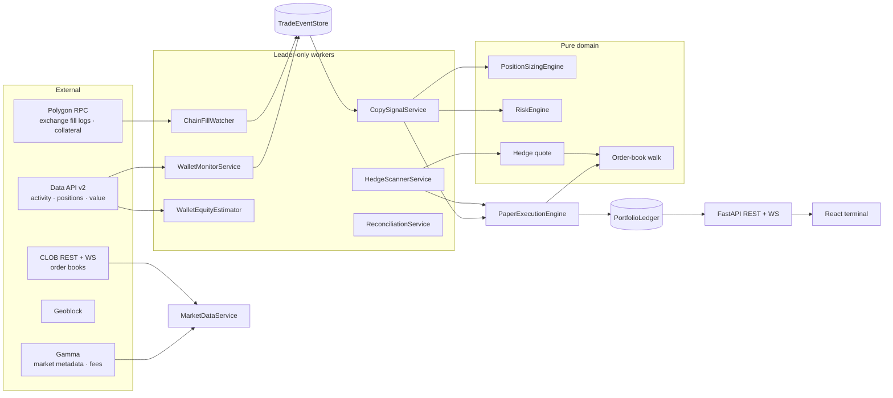
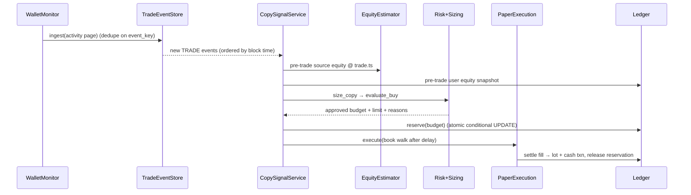

# Architecture

One Python process hosts the HTTP/WebSocket API and (when it wins the leader lock) the
background strategy workers. PostgreSQL is the single source of truth. No broker, no Redis:
every concurrency hazard here is solved by row-level atomic updates and one leader.



## Layers

| Layer | Path | Rule |
|---|---|---|
| Domain | `backend/app/domain` | Pure functions over frozen Pydantic/dataclass models. No I/O, no clock reads. Deterministic for identical inputs. |
| Persistence | `backend/app/db` | SQLAlchemy 2.0 ORM, Alembic migrations, Decimal columns (`NUMERIC(38,18)`). |
| Integrations | `backend/app/integrations` | HTTP/WS adapters that return domain models. Retries with exponential backoff + jitter, honour `Retry-After`. |
| Services | `backend/app/services` | Orchestration: load state, call domain, persist atomically, publish events. |
| Transport | `backend/app/api` | FastAPI routers, auth, WebSocket fan-out. No business logic. |

## Copy pipeline



## Core invariants

1. **No float money.** `Decimal` end to end; JSON numbers from providers are parsed through
   `repr` → `Decimal`. The decimal context traps `FloatOperation`.
2. **Cash conservation.** `cash = starting_bankroll + Σ ledger cash transactions`. Every fill
   writes exactly one cash transaction and its lot/lot-reduction in the same DB transaction.
3. **No overspend.** Reservations use
   `UPDATE accounts SET reserved = reserved + :x WHERE cash - reserved - :floor >= :x`, so
   concurrent signals cannot jointly exceed available cash. A fill can never cost more than
   its reservation.
4. **Never sell what we don't hold.** Sells are planned from ledger inventory minus matched
   (hedged) shares; quantity is capped again inside the ledger write.
5. **Idempotent ingestion.** `source_events.event_key` is unique; copy signals are unique per
   source event; orders carry an idempotency key.
6. **Locked profit only from booked fills.** A position is `FULLY_HEDGED` only after the
   opposite lot exists in the ledger. Open/expected fills never contribute.
7. **Unavailable ≠ zero.** `None` means unknown everywhere; source equity carries coverage
   (`POSITIONS_AND_CASH`, `POSITIONS_ONLY` = lower bound, `UNAVAILABLE`) and confidence.
8. **Single strategy leader.** Workers start only after acquiring a PostgreSQL advisory lock
   (`pg_try_advisory_lock`), so reloads or extra API replicas never double-trade.

## Sizing

```
source_allocation_pct = source_trade_cost / source_pre_trade_equity
copy_budget           = user_pre_trade_equity * source_allocation_pct * multiplier
```

User equity = cash + Σ open lots × conservative mark (mid when two-sided, else best bid).
Source pre-trade equity uses the latest snapshot taken at or before the trade; confidence
decays with snapshot distance and missing cash coverage. Budgets then pass the RiskEngine
(max % per trade, max position, market and portfolio exposure, cash reserve, daily loss,
detection delay, price drift vs source, slippage vs best ask, min liquidity) and finally the
order-book walk, which decides what is executable.

## Hedging

For each open position the scanner walks the complementary token's asks against the
position's lots (cheapest cost basis first) and keeps only segments whose **marginal** net
profit per matched share clears the threshold, then re-prices the chosen quantity through
the same fill simulator used for execution. Fees on both legs, other per-pair costs, depth,
staleness, token mapping and market structure are all checked. See
[`domain/hedge.py`](../backend/app/domain/hedge.py).

State machine: `UNHEDGED → HEDGE_OPPORTUNITY → HEDGE_PENDING → PARTIALLY_HEDGED/FULLY_HEDGED`,
`HEDGE_FAILED` on rejected/failed fills, `SETTLED` terminal.

### Source SELL × hedge interaction

| Policy | Behaviour |
|---|---|
| `PRESERVE_HEDGE` (default) | Source sells reduce only **unhedged** shares. Matched pairs ride to settlement. |
| `UNWIND_IF_BETTER` | On a full source exit, sell matched pairs only if executable bid proceeds of both legs exceed the locked settlement value net of fees. Logged as an explicit event. |

## Execution modes

| Mode | Data | Fills |
|---|---|---|
| `REPLAY` | Recorded book snapshots + source events, strictly ≤ replay clock | Simulated |
| `PAPER` | Live public data | Simulated against live books |
| `LIVE` | Live | Exchange adapter, disabled by default; requires env opt-in, credentials, venue support, and a passing geoblock check at startup and before each order |

See [`polymarket-api-research.md`](polymarket-api-research.md) for endpoint details.
